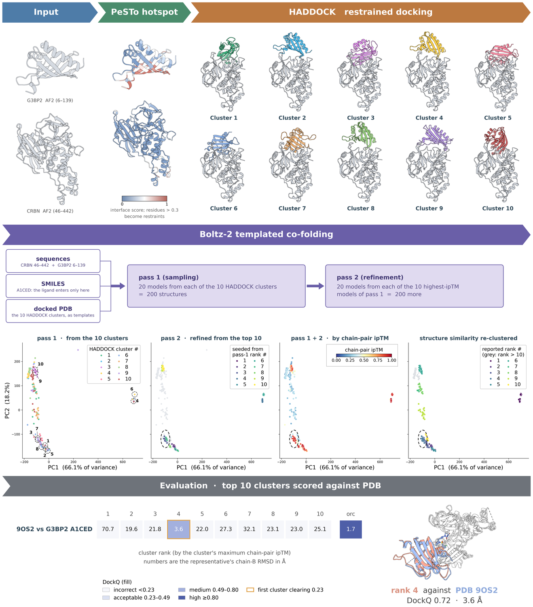

# GluePlex

GluePlex predicts CRBN ternary complexes by giving a co-folding model a
structural prior it does not generate for itself. A geometric interface
predictor restrains a protein-protein docking stage that never sees the glue,
and the docked geometries are handed to Boltz-2 as multi-chain templates. The
small molecule enters only at the co-folding stage, so the protein-protein
frame and the ligand pose are produced by different parts of the method and
can be attributed separately when one of them fails.

This repository holds the pipeline, the CRBN benchmark it was evaluated on,
and the analysis that produces every figure and table in the accompanying
manuscript.

## Citation

The manuscript is in preparation. Until it appears, cite this repository by
its commit.

## The GluePlex pipeline



Four steps, orchestrated by `run_glueplex.py`.

### Step 1 — PeSTo interface prediction

*`tools/apply_model.py`*

Accepts `target_pdb` as a local file or a PDB ID with optional chain
selection. PeSTo scores every residue for the probability of lying in a
protein-protein interface and the score is written into the B-factor column of
`step1_pesto/{base}_pesto.pdb`, which is what Step 2 reads.

### Step 2 — HADDOCK3 docking

Run in the `haddock3` environment, in three parts.

- **`2.0.fetch_active_res.py`** derives the target's active residues when
  `target_active_res` is unset: NACCESS for relative solvent accessibility
  (keeping residues above 15% exposed), the PeSTo B-factors (keeping CA atoms
  at or above 0.3), and the **intersection** of the two. It falls back to
  either alone if the intersection is empty.
- **`2.1.generate_actpass.py`** builds the ambiguous restraints. CRBN uses the
  fixed actives `105,332,341`; the target uses the residues from 2.0. Passive
  residues come from `haddock3-restraints passive_from_active`.
- **`2.2.run_haddock_workflow.py`** normalises chain IDs (CRBN to A, target to
  B) and runs `topoaa` → `rigidbody` (sampling 1000) → `seletop` (200) →
  `flexref` → `mdref` → `clustfcc` → `seletopclusts` (4 models per cluster),
  with `caprieval` after each refinement.
- **`2.3.export_mmcif.py`** converts the top model of every cluster to mmCIF
  with ChimeraX so Boltz-2 can template on it.

The glue is absent throughout Step 2 by design: the docking supplies physical
prior information only.

### Step 3 — Boltz-2, pass 1

Every docked cluster representative becomes one template. Boltz-2 draws 20
diffusion samples per template, with the glue SMILES and both sequences, and
each model is scored on chain-pair ipTM.

### Step 4 — Boltz-2, pass 2

The ten pass-1 structures with the highest chain-pair ipTM between CRBN and
the target become templates for a second pass of 20 samples each, which gives
roughly 20n + 200 structures per compound for n docked clusters. Both passes
are then merged and re-clustered for analysis.

## What is in here

| path | what it is |
|---|---|
| `run_glueplex.py` | the pipeline, all four steps |
| `run_msa_baseline.py` | the no-docking control, which skips straight to co-folding |
| `workflow_scripts/` | the numbered scripts each step calls |
| `tools/apply_model.py` | the PeSTo entry point |
| `tools/PeSTo` | PeSTo itself, a submodule pinned at `ba651aa` |
| `examples/` | one configuration file per arm |
| `env_*.yml` | the three conda environments |
| `VAV1_af2.pdb`, `CRBN_pesto.pdb` | inputs for the worked example |

The CRBN benchmark, the per-model scores and the figure scripts are not in the
repository. They accompany the manuscript as supplementary data.

## Arms

The same pipeline runs six ways, differing in how much structural guidance
Boltz-2 is given before it predicts. Copy the matching file out of
`examples/`. Five are configuration only; the sixth has its own runner because
it skips docking entirely.

| arm | what it docks | interface residues | config |
|---|---|---|---|
| `af` | an AlphaFold model | PeSTo on that model | `examples/arm_af.yaml` |
| `aggaf` | an AlphaFold model | PeSTo unioned over every structure supplied | `examples/arm_aggaf.yaml` |
| `medoid` | the most central experimental chain | PeSTo unioned over every structure supplied | `examples/arm_medoid.yaml` |
| `pesto` | the experimental chain PeSTo scores highest | PeSTo on that chain | `examples/arm_pesto.yaml` |
| `nopesto` | an AlphaFold model | none, so HADDOCK falls back to SASA | `examples/arm_nopesto.yaml` |
| `msa` | nothing, no docking at all | — | `examples/arm_msa.yaml` |

`af` is the default arm and the one the manuscript reports. `msa` runs through
`run_msa_baseline.py`: Boltz-2 with a server MSA, no template and no
restraints, sampling at or above the pipeline's own budget.

`pesto_aggregate` selects the merge strategy for the two arms that aggregate.
It is `union` here; the aggregator also accepts `consensus`, `mean` and
`best`.

Run each arm into its own `project_name`, or the later one will reuse the
earlier one's step directories.

## Prerequisites

The pipeline relies on three specific Conda environments being available on your system. Please ensure these are set up before running the orchestrator:

1.  **`pesto`**: Environment containing the PeSTo model and dependencies (PyTorch, etc.).
2.  **`haddock3`**: Environment containing the HADDOCK3 executable.
3.  **`boltz_analysis`**: Environment containing Boltz2 and analysis tools (Gemmi, BioPython, scikit-learn, Bokeh, etc.).

*Note: The orchestrator (`run_glueplex.py`) explicitly calls `conda run -n [env_name]`. Ensure your environments match these names or update the script/config accordingly.*

## Installation

1.  **Clone the repository**, then fetch PeSTo:
    ```bash
    git clone https://github.com/Hanfeng-Lin/GluePlex.git
    cd GluePlex
    git submodule update --init
    ```
    PeSTo is a submodule pinned at the commit these results were produced
    with. The weights come with it, about 1.3 GB.

2.  **Install NACCESS and UCSF ChimeraX**:
    Ensure `naccess` is installed and available in your PATH. This is required for calculating surface accessibility in Step 2.
    ChimeraX is required for converting PDB to mmCIF in Step 2 and Step 4.

    ```bash
    which naccess
    which chimerax
    ```
    https://www.cgl.ucsf.edu/chimerax/download.html

3.  **PeSTo's entry point**:
    `tools/apply_model.py` is ours and stays in `tools/`. It finds the
    checkout at `tools/PeSTo`, or wherever `--pesto_root` or `$PESTO_ROOT`
    points.

4.  **Create the required Conda environments**:
    
    **PeSTo**
    ```bash
    conda env create -f env_pesto.yml
    ```

    **HADDOCK3**
    ```bash
    conda env create -f env_haddock3.yml
    ```

    **Boltz Analysis**
    ```bash
    conda env create -f env_boltz_analysis.yml
    ```

5.  **Orchestrator** — `run_glueplex.py` needs `PyYAML`.

## Configuration

The pipeline is controlled by a YAML config passed with `--config`. Start from
the arm you want in `examples/` rather than from `project_config.yaml`, which is
wired to one specific run on one host. The keys below are the full set; an arm's
example file is this with the irrelevant parts removed.

```yaml
# General Settings
base_dir: "/path/to/GluePlex"
# project_name: "Result_my_run"  # the output directory. Unset, it is built
                                 # from the two protein names and the ligand.

# Step 1: PeSTo
target_pdb: "./VAV1_af2.pdb"  # Path to target PDB or PDB ID (auto parsing e.g., 1E9H_A)

# Optional. Other structures of the same target; PeSTo runs on each and the
# predicted interface residues are merged into target_pdb's numbering.
# Unset = single-structure behaviour, i.e. the `af` arm.
# pesto_extra_pdbs:
#   - "./structures/TARGET_1abc_A.pdb"
# pesto_aggregate: union        # union | consensus | mean | best
# pesto_threshold: 0.3          # a residue is active at or above this score

# Optional. Skip PeSTo and write target_pdb out with zeroed B-factors, so
# step 2 finds no interface residues and falls back to SASA. The `nopesto`
# arm. Requires target_pdb to be a local file, not an ID.
# skip_pesto: true

# Step 2: HADDOCK3
# Active residues for Target. If empty, they will be fetched automatically
# through PeSTo score and SASA filtering.
# target_active_res: "1,3,9,10,..."
# crbn_active_res: "105,332,341"  # the fixed partner's actives; this is the default
haddock_run_dir: "haddock_results"
haddock_ncores: 80
# haddock_mode: mpi               # mpi | local
# haddock_seed: 917               # CNS iniseed. haddock3 defaults to 917.

# Step 3: Boltz2 (Pass 1)
step3:
  protein_a_name: "CRBN"
  protein_a_sequence: "..."
  protein_b_name: "VAV1"
  protein_b_sequence: "..."
  ligand_name: "NGT-201-12"
  ligand_smiles: "..."
  diffusion_samples: 20
  gpus: [0,1,2,3,4,5,6,7]

# Step 4: Boltz2 (Pass 2 — double-pass refinement)
step4:
  top_n: 10                        # number of pass-1 templates to carry into pass-2
  diffusion_samples: 20            # samples per pass-2 job
  rank_metric: pair_chains_ipTM_avg
  gpus: [0,1,2,3,4,5,6,7]
```

## Usage

Run the pipeline using the `run_glueplex.py` script.

### Run the Full Pipeline (all 4 steps)
```bash
python run_glueplex.py --config project_config.yaml
```

The project directory is automatically named `Result_{protein_b}_{protein_a}_GluePlex2pass` (e.g., `Result_VAV1_CRBN_GluePlex2pass`).

### Run without double-pass (Steps 1-3 only)
```bash
python run_glueplex.py --config project_config.yaml --no-doublepass
```

### Run Specific Steps
You can run individual steps using the `--step` argument:

*   **Step 1 only (PeSTo)**:
    ```bash
    python run_glueplex.py --step 1
    ```
*   **Step 2 only (HADDOCK3)**:
    ```bash
    python run_glueplex.py --step 2
    ```
*   **Step 3 only (Boltz2 Pass 1)**:
    ```bash
    python run_glueplex.py --step 3
    ```
*   **Step 4 only (Boltz2 Pass 2)**:
    ```bash
    python run_glueplex.py --step 4
    ```

### Reference PDB for RMSD Evaluation

When a ground-truth crystal structure is available, use `--ref` to compute chain B CA RMSD for each predicted model:

```bash
python run_glueplex.py --config project_config.yaml --step 3 --ref groundtruth.pdb
```

The reference PDB must contain exactly 3 chains (A: fixed partner, B: target, C: ligand). For each model, chain A is aligned to the reference chain A using sequence alignment (BioPython `PairwiseAligner`) and structural superposition (`Superimposer`), then chain B CA RMSD is measured against the reference chain B. This handles different residue numbering, chain truncations, and missing density gaps.

The `ref_rmsd` column is added to `atom.csv` / `atom_2ndpass.csv`, and an additional `PCA_ref_rmsd` / `UMAP_ref_rmsd` plot is generated (color range 0–10 Å, clamped).

For targets with multiple ground-truth conformations (e.g., active/inactive), the helper script can be run directly:
```bash
# Compute RMSD against active conformation
python workflow_scripts/_ref_align_rmsd.py \
    --ref_pdb active.pdb \
    --input_csv atom.csv \
    --results_dir CRBN-TARGET \
    --align_chain A --extract_chain B

# Regenerate plots, then rename with suffix
python workflow_scripts/_pca_coord_energy.py \
    --input_csv atom.csv \
    --ligand_name LIGAND --protein_name TARGET --protein_a_name CRBN
mv PCA_ref_rmsd_CRBN_TARGET.png PCA_ref_active_CRBN_TARGET.png
```

## Output Structure

```
Result_VAV1_CRBN_GluePlex2pass/
├── input/                          # Copies of input files and config
├── logs/                           # Log files for each step
│   ├── step1_pesto.log
│   ├── step2_haddock.log
│   ├── step3_boltz.log
│   └── step4_double_pass.log
├── step1_pesto/                    # PeSTo outputs (predicted PDBs)
├── step2_haddock/                  # HADDOCK3 run directory and mmCIF exports
│   ├── haddock_results/            # Full HADDOCK3 output
│   ├── restraint.tbl               # Generated restraints
│   └── *.cif                       # Exported models for Boltz
├── step3_boltz/                    # Boltz Pass 1 predictions and analysis
│   ├── boltz_results/              # Raw Boltz outputs
│   ├── CRBN-VAV1/                  # Flattened results (PDBs, JSONs)
│   ├── atom.csv                    # Summary CSV with scores, coords, and ref_rmsd
│   ├── top10_models.log            # Top 10 models (with ref_rmsd if --ref used)
│   ├── PCA_*_CRBN_VAV1.html/png    # Interactive + static PCA plots
│   └── UMAP_*_CRBN_VAV1.html/png   # Interactive + static UMAP plots
└── step4_boltz/                    # Boltz Pass 2 (double-pass refinement)
    ├── templates_cif/              # Pass-1 PDBs converted to mmCIF for templating
    ├── pass2_manifest.txt          # List of pass-2 run scripts
    ├── pass2_template_mapping.log  # Source PDB → pass-2 template name mapping
    ├── boltz_results/              # Raw Boltz Pass 2 outputs
    ├── merged_pdbs/                # Symlinks to all Pass 1 + Pass 2 PDBs/JSONs
    ├── CRBN-VAV1_2ndpass/          # Flattened merged results
    ├── atom_2ndpass.csv            # Combined CSV for both passes
    ├── PCA_*_CRBN_VAV1.html/png    # Combined PCA plots
    └── UMAP_*_CRBN_VAV1.html/png   # Combined UMAP plots
```

## Analysis

### Plot Types

The post-analysis generates plot variants in both PCA and UMAP, each as interactive HTML (Bokeh) and static PNG:

- **`cluster`** — colors by HADDOCK3 cluster ID (Pass 1) or pass-2 template rank.
- **`chainpair_ipTM`** — colors by the average ipTM score between chain A (e.g., CRBN) and chain B (target protein), the most relevant metric for molecular glue interfaces.
- **`ipTM`** — colors by the overall ipTM score of the model.
- **`ref_rmsd`** — colors by chain B CA RMSD against the reference crystal structure (range 0–10 Å). Only generated when `--ref` is provided.

### Reference RMSD

The `--ref` flag enables ground-truth comparison. The alignment uses:
1. **Sequence alignment** (`Bio.Align.PairwiseAligner`) to pair residues regardless of numbering
2. **Structural superposition** (`Bio.PDB.Superimposer`) on paired chain A CAs
3. **Chain B RMSD** measured after chain A alignment (no re-superposition of chain B)

This handles common mismatches between crystal structures and predicted models (different residue ranges, missing density, truncated chains).

## Software versions

| | version |
|---|---|
| Boltz-2 | 2.2.1 (Python 3.12.12, PyTorch 2.9.1, CUDA 12.8) |
| HADDOCK3 | 2025.11.0 (Python 3.9.25, PyTorch 2.8.0) |
| PeSTo | commit `ba651aa`, checkpoint `i_v4_1_2021-09-07_11-21` |
| AlphaFold DB | monomer v2.0 models, retrieved 2025-08-01 |
| RDKit | 2025.9.3 in the prediction environment, 2024.09.6 in analysis |
| analysis | Python 3.12.4, NumPy 1.26.4, SciPy 1.16.3, pandas 2.3.3, Biopython 1.86 |
| rendering | Matplotlib 3.10.8, UCSF ChimeraX 1.10.1 |

